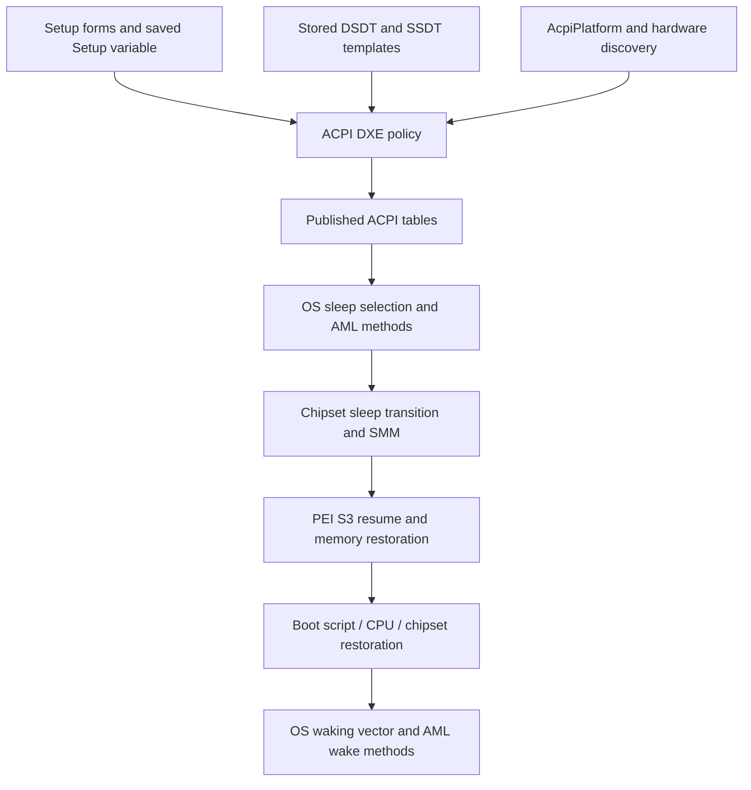

# PR9 and MR9A PRO: ACPI, sleep, and BIOS-mod research

> Paths under `work/` name files of the local workspace. They are not published: they hold vendor firmware bytes, tool output or machine identifiers.

Current cross-board audit: [ranked findings and patch register](../findings/), including boot, SIO, SMM, ACPI and reporting defects, with separate finding/fix confidence and reproducible evidence.

Initial analysis: 2026-11-04. These notes apply to the **two supplied images**, not every revision sold under these board names. The initial comparison was read-only. Subsequent work built and flashed the menu mod linked in section 9; the user enabled S3 and reported a failed real resume. All five staged pm_test diagnostics later passed once. The follow-ups at the end record these results and the current investigation plan; the initial-state observations below are historical.

## Main finding

PR9 retains working-looking S3 policy code and much of the same resume infrastructure as MR9A. Its Setup forms expose only `Suspend Disabled`, its defaults select that value, and its ACPI driver consequently hides S3 from the OS. The running PR9 confirms the result: `_S3_` becomes `XS3_`, `SS3` becomes zero, and Linux reports `supports S0 S4 S5` and only `[s2idle]`.

The strongest mod lead is **PR9's own Setup-controlled ACPI policy**, not a wholesale MR9A firmware transplant. Presence of code establishes a useful investigation path, not successful DRAM retention or resume.

## Evidence and reproducibility

| Input | SHA-256 |
|---|---|
| `pr9-read1.bin` | `095a6f5a15c56b245f38044c53298c03f3fb5cb13294ce5f0ebaa84cd57375ec` |
| `MNX99MR9APRO_230322_original_90DEDD1D.bin` | `4036d26e7ff72160625fd8a1d9cc33095116d02342f7e5398f7fdb1bfb71b2a6` |

Both are 16 MiB flash images with Intel flash regions and AMI UEFI firmware. Filenames are supplied labels; the PR9 dump also contains populated NVRAM/history, whereas MR9A is labelled original. Do not confuse saved defaults, historical variable records, and current active values.

Both parse with descriptor at `0x000000..0x000FFF`, ME region at `0x001000..0x7FFFFF`, and BIOS region at `0x800000..0xFFFFFF`. Descriptor and ME region CRCs differ between the images, as do their BIOS contents. Shared region boundaries do not establish cross-flash compatibility. The parser’s invalid/unused FPT entries should not by themselves be interpreted as damaged ME firmware.

Tools: [UEFIExtract A76](https://github.com/LongSoft/UEFITool/releases/tag/A76), [IFRExtractor-RS 1.6.1](https://github.com/LongSoft/IFRExtractor-RS/releases/tag/v1.6.1), ACPICA `iasl` 20251212, GNU `objdump`, and Python 3. Tools downloaded for this work reside in `work/analysis/tools/`.

Artifacts:

- Original comparison (`work/analysis/comparison.md`), module comparison (`work/analysis/module-comparison.md`), payload hashes (`work/analysis/module-hashes.json`).
- PR9 Setup IFR (`work/analysis/pr9/Setup.pe.0.0.en-US.uefi.ifr.txt`), MR9A Setup IFR (`work/analysis/mr9a/Setup.pe.0.0.en-US.uefi.ifr.txt`).
- PR9 DSDT (`work/analysis/pr9/DSDT-32f8c.dsl`), MR9A DSDT (`work/analysis/mr9a/DSDT-3360d.dsl`), live PR9 DSDT (`work/analysis/live/DSDT.dsl`).
- PR9 ACPI policy assembly (`work/analysis/pr9/acpi-policy.asm.txt`), MR9A ACPI policy assembly (`work/analysis/mr9a/acpi-policy.asm.txt`).
- PR9 table inventory (`work/analysis/pr9/tables.json`), MR9A table inventory (`work/analysis/mr9a/tables.json`), method comparison (`work/analysis/method-comparison.json`).
- Live hardware/kernel evidence (`work/analysis/live/runtime.txt`), live table binaries and disassemblies in `work/analysis/live/`.
- Extraction script (`work/analysis/scripts/explore.py`) and comparison script (`work/analysis/scripts/summarize.py`). Run from this directory after extracting both images with UEFIExtract `all`. These read the extraction trees and ACPI sysfs files and write analysis artifacts only.

The `*.bin.dump` trees and `*.report.txt` files are full UEFIExtract output. `work/analysis/{pr9,mr9a}/modules/` contains selected PE payloads, assembly, and metadata. `objdump` disassembles data embedded in executable sections too: arbitrary apparent instructions in those sections are not automatically executable code.

## 1. ACPI implementation layers



This is the architectural path, not a completely recovered call graph. The policy and AML sections below are directly traced. The full PEI memory-resume and SMM dispatch paths remain only partly characterized.

Key firmware files shared by GUID:

| Role | Firmware file GUID |
|---|---|
| Setup forms | `899407D7-99FE-43D8-9A21-79EC328CAC21` |
| ACPI driver / sleep advertisement policy | `16D0A23E-C09C-407D-A14A-AD058FDD0CA1` |
| AcpiPlatform | `87AB821C-79B8-4EF6-A913-21D22063F55F` |
| File containing DSDT raw section | `7E374E25-8E01-4FEE-87F2-390C23C606CD` |
| AcpiSmmPlatform | `F5AC7057-5650-466E-B692-76A47223EFB0` |
| PchS3Peim | `271DD6F2-54CB-45E6-8585-8C923C1AC706` |
| S3Resume | `EFD652CC-0E99-40F0-96C0-E08C089070FC` |
| S3Resume2Pei | `89E549B0-7CFE-449D-9BA3-10D8B2312D71` |

Use GUID and parsed section identity when locating objects. Compressed file offsets, PE-relative addresses, variable offsets, and AML offsets are different address spaces.

## 2. Stored tables versus runtime tables

The scanner recovered checksum-valid ACPI headers in extracted raw and PE32 sections, deduplicated by SHA-256. This inventory is **not** an exhaustive list of all tables firmware can construct: fixed tables such as FADT/MADT can be built dynamically or stored as incomplete templates without a valid final checksum.

| Stored table | PR9 size | MR9A size | Interpretation |
|---|---:|---:|---|
| DSDT `A M I` | 208,780 | 210,445 | Main namespace, chipset, SIO, PCI routing, wake and sleep methods |
| SSDT `SSDT HWP` | 166,500 | 321,636 | CPU/HWP-related template; not published on this PR9 boot |
| SSDT `PmMgt` | 86,651 | 86,915 | Processor power-management template |
| SSDT `IdeTable` | 1,173 | 1,173 | Legacy storage namespace template |
| SSDT `SataTabl` | 877 | 877 | SATA namespace template |
| SSDT `PttSsdt` | absent from recovered set | 65 | Additional TPM/PTT-related template |

Table names and method contents support the interpretation column; inclusion in an image does not establish that a table is installed on every boot. The small IDE and SATA templates are byte-identical across images. Large CPU tables differ and should not be copied casually.

Live PR9 publishes `APIC`, `BGRT`, `DMAR`, `DSDT`, `FACP`, `FACS`, `FIDT`, `FPDT`, `HPET`, `MCFG`, `MSCT`, `SLIT`, `SRAT`, two SSDTs, `UEFI`, `VFCT`, and `WDDT`. Runtime SSDTs are `SataTabl` and `PmMgt`; `PmMgt` is patched from 86,651 to 86,251 bytes. Live table presence does not imply every table originated in the motherboard's ROM; graphics firmware, for example, can contribute platform data.

DSDT patches extend well beyond the sleep name: PCI resources, address placeholders and policy values change at boot. Raw stored-table transplantation would lose those adaptations. No MR9A runtime capture was available, so its final table set, actual S1 advertisement, and successful S3 behavior were not measured here.

### Live PR9 FADT and FACS

See FADT (`work/analysis/live/FACP.dsl`) and FACS (`work/analysis/live/FACS.dsl`).

| Item | Value |
|---|---|
| FADT | revision 5, 268 bytes, Desktop profile |
| SCI interrupt | 9 |
| SMI command port / ACPI enable / disable | `0xB2` / `0xA0` / `0xA1` |
| PM1a event / control | `0x400` / `0x404` |
| PM timer / PM2 control | `0x408` / `0x450` |
| GPE0 | `0x420`, length `0x10` |
| FADT flags | `0x84A5` |
| Hardware-reduced ACPI | false |
| Low Power S0 Idle Capable | false |
| Reset | system I/O `0xCF9`, value `0x06` |
| S4BIOS command / FACS S4BIOS support | zero / false |
| FACS | version 2, 64 bytes; waking vectors zero at capture |

This is a conventional PM1-register ACPI platform. `s2idle` availability does not establish Modern Standby/S0ix support; the FADT low-power-S0 capability is clear. Zero waking vectors in an awake snapshot do not prove that the S3 resume path is missing: the OS normally prepares the wake handoff for a sleep transition.

The DSDTs both define `PMBA=0x400`, `SMCR=0x430`, `SMIP=0xB2`, `GPBS=0x500`, and `SMBS=0x580`. PR9's live PCI identity includes B85 LPC `8086:8c50` and 8-series/C220 USB/SATA controllers. X99 product branding is insufficient to select chipset initialization or a donor ROM. MR9A physical chipset identity was not measured.

## 3. Sleep states actually represented

| State | PR9 stored AML | MR9A stored AML | Live PR9 / implication |
|---|---|---|---|
| S0 | `_S0={0,0,0,0}` | same | Present |
| S1 | no root `_S1` declaration recovered | no root `_S1` declaration recovered | Not advertised; MR9A menu choice alone is insufficient |
| S2 | no root `_S2`; `SS2=0` | same | Not advertised |
| S3 | `_S3={5,0,0,0}`, `SS3=1` | same | Renamed `XS3`; `SS3=0`; unavailable |
| S4 | `_S4={6,0,0,0}`, `SS4=1` | same | Present; OS hibernation path available |
| S5 | `_S5={7,0,0,0}` | same | Present; soft-off |

The values 5/6/7 are platform sleep-type encodings, not state numbers. In particular, Setup choice **2** selects the S3 policy; `_S3` encodes sleep type **5**. Do not substitute one for the other.

For S1, neither the recovered DSDT nor recovered SSDTs supply the missing root package. The generic ACPI driver can retain/hide an `_S1` object if one exists, but that does not create one. S1 on MR9A must be checked with runtime tables after selecting it before documenting it as supported. S2 has neither a setup choice nor evidence of implementation.

S4 is conventional OS-managed hibernation here; no legacy S4BIOS implementation is advertised in live PR9. Successful hibernation still depends on the OS, storage and drivers. S5 RTC wake and LAN wake settings concern wake policy; their presence does not enable S3.

Linux's `freeze`, `mem`, and `disk` strings are API choices, not proof of particular hardware states. `mem` currently maps to s2idle on this PR9. `mem_sleep_default=deep` cannot create missing firmware S3 support.

## 4. Setup controls and defaults

Shared variable identity: `Setup`, GUID `EC87D643-EBA4-4BB5-A1E5-3F3E36B20DA9`. The field offsets differ between builds.

| Setting | PR9 payload offset | MR9A payload offset | Notes |
|---|---|---|---|
| Auto ACPI configuration | `0x09`, byte | `0x29`, byte | Default 0; when enabled, hides manual controls and bypasses their policy override |
| ACPI Sleep State | `0x0A`, word | `0x2A`, word | PR9: only 0; MR9A: 0 disabled, 1 S1, 2 S3 |
| Lock Legacy Resources | `0x0C`, byte | `0x2C`, byte | Adjacent field; do not overwrite accidentally |
| Enable Hibernation | `0x0D`, byte | `0x2D`, byte | Explicit default opcode sets 1 |
| Restore PCIe Registers | `0x47`, byte | `0x5A`, byte | Compatibility option for S3 PCIe restoration; not the sleep-enable gate |
| LAN wake | `0x12`, byte | `0x72`, byte | PR9 named Wake on LAN; MR9A Lan Wake up Control |

PR9 additionally has Restore AC Power Loss at `0x11`, S5 RTC wake mode at `0x2F`, fixed hour/minute/second at `0x30..0x32`, and relative wake minutes at `0x33`.

PR9 Setup payload length is `0x6C`; MR9A is `0x7D`. The extracted standard-default payloads confirm sleep word 0 for PR9 and 2 for MR9A. IFR has separate checkbox flags and explicit Default opcodes: for hibernation, the explicit default is 1 despite the extractor's checkbox-flag text saying Disabled.

PR9 Sleep State question is ID `0x19`, IFR/PE offset `0xA4BB`; its only option follows at `0xA4CF`, and its declared minimum/maximum are both zero. MR9A question is ID `0x31`, offset `0xE394`, with three options. The offsets are for the extracted Setup PE, not flash addresses.

Manual ACPI controls sit under suppression when Auto Configuration is 1, and grey-out conditions also reference other setup questions. Those conditions must be considered when editing visibility; exposing a form alone does not change saved policy or guarantee hardware support.

## 5. Recovered ACPI driver policy

The critical code is in **ACPI**, not merely AcpiPlatform. Both extracted PEs have image-relative addresses matching raw file offsets in this region (image base zero and equal section RVA/raw offsets). Recheck this mapping on any other build.

### Setup-to-policy conversion

At `0x7A7E`, the driver initializes an internal context:

- context `+0x40`: S1 permission, initially 0.
- context `+0x41`: S2 permission, initially 0.
- context `+0x42`: S3 permission, initially 1.
- context `+0x43`: S4 permission, initially 1.

It reads `Setup` with the shared GUID. After a successful read, the branch at `0x7B15` checks Auto Configuration. When that byte is zero, it loads hibernation and the 16-bit sleep selection:

```text
S1 = 0; S2 = 0; S3 = 1; S4 = 1
if Setup read succeeds and AutoConfiguration == 0:
    S4 = EnableHibernation
    if SleepSelection == 0: S1 = 0; S3 = 0
    if SleepSelection == 1: S1 = 1; S3 = 0
    if SleepSelection == 2: S1 = 1; S3 = 1
```

The selection-2 branch permits S1 as well as S3 internally, but permission is not a substitute for an AML `_S1` declaration. Other selection values leave initial S1/S3 defaults; they are not documented setup options.

**PR9 already contains the selection-2 branch.** In the `0x7B15..0x7B4D` span, the two builds differ only in the three Setup displacement bytes (`09/0D/0A` versus `29/2D/2A`). This confirms the field mapping independently of IFR. It does not establish that early PEI/SMM code honors an unsupported PR9 setting everywhere.

Auto Configuration appears to retain generic default permissions in this driver rather than overriding them from manual settings. Whether another producer or setup validation alters the result requires testing; this observation is not a validated enablement procedure.

### Policy-to-AML conversion

The function at `0x7574` scans the DSDT and patches its names/values. The examined bytes through `0x7711` are identical across both images.

| Condition | Search target | Action/address |
|---|---|---|
| context `+0x42 == 0` | `_S3` | first character changed to `X`, write at `0x75C4` |
| context `+0x40 == 0` | `_S1` | first character changed to `X`, write at `0x75EA` |
| context `+0x43 == 0` | `_S4` | first character changed to `X`, write at `0x7610` |

Search strings are at `0x1FF8`, `0x1FFC`, `0x2000`. The routine also patches `SS4`, `SS3`, `SS2`, and `SS1` from the context, and other platform fields including `TOPM` and `IOST`. This matters because forcing only `_S3` visible can leave device-wake calculations inconsistent.

The same routine recalculates the DSDT checksum at `0x76BB..0x76FE` after patching, rather than leaving the renamed table with its old checksum. An offline AML edit must likewise preserve table length/structure and checksum.

Live PR9 confirms this exact policy outcome: the stored AML name at DSDT offset `0x2F03D` is `_S3_`, while runtime has `XS3_`; `SS1/SS2/SS3/SS4` change from `1/0/1/1` to `0/0/0/1`. This is not an OS menu issue.

## 6. AML sleep entry and wake paths

### Common structure

`_PTS(state)` calls Super I/O `SIOS`, LPC `SPTS`, then `IPTS` when the argument is nonzero. MR9A additionally calls `\_SB.TPM.TPTS(state)`. PR9 lacks that extra TPM preparation call in its root `_PTS`.

`_WAK(state)` is identical: `IWAK` → LPC `SWAK` → SIO `SIOW`, then return `WAKP`. The helper package begins `{0,0}`. `_GTS(state)` writes the requested state to diagnostic `IO80`.

`IPTS`, identical between images:

- writes diagnostic `0x72`;
- writes a collection of USB/PME/GPE status and enable fields;
- for S3 only, writes `SMIS=0xE0` and `SMIC=0xBE`.

`IWAK`, also identical:

- writes diagnostic `0x73`;
- notifies EHC1/EHC2 with Bus Check;
- calls XHCI `XWAK` on S3 or S4;
- for S3 only, writes `SMIS=0xE1`, `SMIC=0xBE`.

`SMIC` is I/O `0xB2`; `SMIS` is `0xB3`. These show an AML-to-SMI interface. The exact firmware handlers for these BE/E0/E1 combinations have **not** been conclusively mapped; do not assign them to a particular SMM module solely from its name.

LPC `SPTS` sets `SLPX` and `SLPE`; `SWAK` clears `SLPE` and notifies the power button unless RTC status is set. These fields live in `SLPR`, based at `SMCR=0x430`; they are SMI-related fields, not the FADT PM1a control register's sleep-type/enable fields. The similar names should not be conflated.

XHCI `XWAK` calls `XSEL(1)` and notifies XHCI when `XUSB` or `XRST` is 1. This method is identical in both DSDTs.

### Super I/O differences that matter to a mod

Both enter logical device `0x0A`, manipulate `OPT2/3/4/6`, then exit configuration mode, but their sleep handling is not equivalent:

- **PR9 SIOS:** skips the programming block for S5; clears status, then uses `KBFG` and `MSFG` to set/clear bits `0x10` and `0x20` in `OPT6`; sets bit 0 in `OPT2`.
- **MR9A SIOS:** no equivalent S5 guard; saves status, clears both bits, then unconditionally sets both keyboard/mouse-related bits and sets `OPT2` bit 0.
- **PR9 SIOW:** saves `OPT3`, clears `OPT3`, clears `OPT6` bits `0x30`, clears `OPT2` bit 0.
- **MR9A SIOW:** performs those operations and also clears `OPT4`.

The bit purposes are inferred from nearby keyboard/mouse flags, not independently validated against the Super I/O datasheet. These are direct reasons to preserve PR9's board-specific AML rather than transplant MR9A's whole DSDT. `SioDxeInit` payloads also differ substantially.

## 7. Wake resources and device power

The PR9 DSDT contains 56 `_PRW` methods; MR9A has 59. Both have three `_S3D` and three `_S4D` methods. Counts describe the stored DSDT only, not the entire runtime namespace or proven wake devices.

Shared `GPRW(gpe, deepestState)` builds wake packages using `SS1..SS4`. If the requested deepest state is disabled, it chooses an available state using an OS-dependent bit search. Thus `SS3` is part of wake-resource policy, not decorative metadata.

Examples from PR9:

- XHCI `_PRW` returns `GPRW(0x0D, 4)`.
- IP2P `_PRW` returns `GPRW(0x0B, 3)`.
- EHCI and PCIe ports have additional wake methods and PME/GPE handling.

Live `/proc/acpi/wakeup` lists USB, chipset/CPU PCIe ports and GLAN; many template devices have no active PCI device. Its S4 column describes the reported deepest wake state, not the currently selected suspend state. An enabled wake entry does not guarantee that an endpoint, slot or power rail can actually wake the machine.

## 8. S3 save/restore infrastructure

Full module comparison (`work/analysis/module-comparison.md`) records PE sizes and byte differences. These byte-identical payloads are particularly useful evidence of shared infrastructure:

`PchS3Support`, `S3Save`, `S3NvramSave`, `AcpiS3SaveDxe`, `S3SupportSmm`, `S3SaveSmm`, `MtrrS3SaveRestoreDxe`, `MtrrS3SaveRestoreSmm`, `BootScriptHideDxe`, `BootScriptHideSmm`, and `SmmLockBox`.

`PpmInitialize` and `CRBSmi` are also identical in this comparison. `S3Resume` differs at only 102 byte positions in equal 7,136-byte payloads; `S3Resume2Pei` differs at 123 positions in equal 4,160-byte payloads; `MtrrS3SaveRestorePei` differs at 12 positions. Small differences may include PE metadata, relocation/build addresses or real policy changes; they have not all been semantically classified.

`PchS3Peim`, `PlatformEarlyInit`, `PchInitPeim`, `PchInitDxe`, `UncoreInitPeim`, `AcpiPlatform`, and `AcpiSmmPlatform` differ more substantially. These are priority targets if an eventual PR9-only S3 policy change advertises deep sleep but fails to resume.

Architecturally, S3 needs early resume detection, DRAM preserved/restored without destructive cold training, CPU/cache state restoration, boot-script/chipset restoration, and transfer to the OS waking vector. Module names are consistent with this division, but this analysis has not recovered every call or verified execution. FACS, NVS allocations, save modules, and boot scripts must be considered together; a visible `_S3` is only the advertisement layer.

## 9. BIOS-mod section: candidate scope and review requirements

A subsequent offline candidate is available in mods/pr9-s3-select-v1 (`work/mods/pr9-s3-select-v1/README.md`). It adds the S3 menu option while retaining Disabled as both defaults. It passed static validation and was later flashed with verified readback. Its first S3 hardware test failed to resume; see test findings (`work/mods/pr9-s3-select-v1/testing/README.md`). The no-candidate statement below describes the original research, superseded by this linked deliverable.

### Best-supported candidate

Investigate enabling **selection 2 in PR9's existing policy**, preserving its ACPI/SIO/chipset/memory code. The current image's form and defaults are the first confirmed restriction; its ACPI code already interprets value 2.

A durable firmware implementation would need to address all relevant layers:

1. Restore an appropriate PR9 Setup form option, allowed range, strings and defaults, with correct IFR scopes/package sizes.
2. Decide how existing NVRAM is migrated or explicitly configured: changing defaults alone need not change an existing saved Setup variable.
3. Preserve `Setup` size/layout/GUID and adjacent bytes. The sleep field is 16-bit, even though its allowed values fit in a byte.
4. Verify early initialization and SMM do not independently disable or mishandle the selected mode.
5. Confirm the published `_S3`, `SS3`, wake packages and FADT are coherent, then validate actual suspend/resume on PR9 hardware.

These are research requirements, not a tested patch recipe. The subsequent candidate linked above implements the menu-only change; no EFI variable writer is included.

### Other possible interventions and their limits

| Intervention | What it could establish | Main limitation |
|---|---|---|
| Expose Setup menu only | A selectable control | Current range/option set and saved value also matter |
| Change default only | New fallback/default value | Existing NVRAM can retain 0 |
| Set PR9 sleep word through a controlled experiment | Whether existing policy permits S3 | Firmware can validate/reset it; early resume remains unproven |
| Use Auto Configuration | This ACPI driver retains generic permissions | Other configuration paths untested; no validated enablement result |
| Force `_S3` visible in AML | OS sees an S3 declaration | Does not restore SS3/wake policy, DRAM or chipset resume |
| Bypass the rename branch | Removes one advertisement gate | Leaves broader policy inconsistent and masks why it was disabled |
| MR9A module/DSDT transplant | Supplies donor implementation | Variable layouts, SIO, TPM, chipset/memory initialization differ |
| Full MR9A cross-flash | Replaces the entire firmware | Not supported by this analysis; board identity and initialization mismatch |

For S1, first locate a runtime/generated `_S1` implementation or establish its absence. Adding a menu option without a valid sleep package and hardware behavior is insufficient. No evidence supports pursuing S2 as a simple enable bit.

### Validation plan for a future authorized experiment

Before making a persistent mod, retain a verified full PR9 backup and a practical recovery route. Review the candidate with a firmware parser and ensure only intended regions/files changed, keeping board-specific flash descriptor, ME, identities and NVRAM handling deliberate.

After booting a candidate, first capture tables and logs without entering sleep. Check `_S3` visibility, `SS3`, `/sys/power/mem_sleep`, kernel supported-state messages, and wake packages. Advertisement success is a separate milestone from resume success.

Then test with controlled workloads and recorded outcomes: wake source, time asleep, power behavior, memory integrity, storage, USB, LAN, PCIe and graphics recovery; repeat cycles and compare warm/cold boot behavior. GPU black screen, immediate wake and complete failure to resume are distinct symptoms. CPU/DRAM configuration and firmware settings should be recorded because memory training and resume can depend on them. Such tests interrupt the machine and were not performed here.

## 10. Remaining questions

- Why did the PR9 vendor restrict the form/default—unimplemented board power sequencing, unreliable resume, or product configuration? The binaries establish the restriction, not its motive.
- Does PR9 Setup accept and retain selection 2, and do all early policy consumers agree?
- Which SMM handler receives AML command BE with E0/E1, and what does it save/restore?
- Are small PEI resume differences merely build addresses or meaningful changes?
- What are the board's actual DRAM retention and sleep power-rail connections?
- What does a real MR9A publish after choosing S1 or S3, and which wake methods work there?

## Primary references

The firmware-specific claims above come from the linked local artifacts. General state semantics and the OS/firmware handoff follow [ACPI 6.6, Waking and Sleeping](https://uefi.org/specs/ACPI/6.6/16_Waking_and_Sleeping.html). Linux user-interface meanings follow [Linux system sleep states](https://www.kernel.org/doc/html/latest/admin-guide/pm/sleep-states.html). Neither reference establishes these boards' physical resume reliability.


## Follow-up: failed-resume diagnosis

Comparison-based diagnosis (`work/mods/pr9-s3-select-v1/testing/diagnosis.md`) refines the module comparison: S3Resume, S3Resume2Pei and MtrrS3SaveRestorePei are identical after PE rebasing. It adds IntelRCSetup power/default comparisons and ranks later tests. No disruptive tests or further firmware changes were performed in that follow-up.

The subsequent authorized pm_test run (`work/mods/pr9-s3-select-v1/testing/pm-test/README.md`) passed freezer, devices, platform, processors and core once each without entering real S3. This narrows the investigation but does not establish successful firmware resume or exclude drivers that fail only after hardware state loss.

## Follow-up: reverse-engineering and patch workflow

The PR9 S3 reverse-engineering plan (`work/analysis/reverse-engineering/README.md`) documents extraction, typed C-like decompilation, function matching, resume checkpoints, hardware limits and targeted PEI/DXE/SMM patch validation. Additional comparison shows GenericSio is byte-identical and NCT5532DPeiInit still differs after relocation normalization. No defective instruction or functional resume repair has yet been established.

## Follow-up: Ghidra workbench and specific patch candidates (2026-11-06)

The installed workbench (`work/analysis/reverse-engineering/setup.md`) contains Ghidra 12.2, the rebuilt firmware extension, NASM, paired projects for 36 modules per board, C/assembly exports and function comparisons. A fresh read-only dump of the installed MR9A PRO/Q87 confirmed that the relevant supplied MR9A module payloads match the running comparison firmware.

New findings (`work/analysis/reverse-engineering/findings-20261106.md`) identify two concrete differences: PR9's post-memory processing lacks MR9A's S3 guard around the ME/UMA completion helper, and PR9's OEM S3 entry callback clears PME_B0_EN while sharing its S4/S5 cleanup path. These are patch hypotheses, not a confirmed explanation of the CMOS-clear-only boot recovery. Nuvoton documentation identifies the donor's specific SIO E0 write as PS/2 wake configuration.

## MR9A live firmware consistency audit — 2026-11-06

MR9A audit and fresh evidence (`work/analysis/reverse-engineering/mr9a-audit/README.md`) document incorrect SMBIOS DIMM widths, a rated-versus-reported memory-speed discrepancy, ACPI/GPIO ownership overlaps, a PCIe common-clock configuration corrected by Linux, ASPM and x2APIC policy restrictions, and obsolete OS detection. Current EDAC reports an ECC mode on all four RDIMMs. The installed March-2023 firmware and the separate November-2023 `motherboards/mr9a_pro_rev_1.2/bios-1.bin` are distinct builds; the directory label does not establish cross-flash compatibility. This audit changed no firmware or hardware settings and performed no suspend test.

Intermittent memory-POST investigation (`work/analysis/reverse-engineering/boot-investigation/README.md`) finds a concrete robustness gap: the original iMC SPD reader can loop indefinitely without reaching its controller-recovery branch. Twelve fault-injection/control cases executed the original reader instructions from March MR9A, PR9 and the separate November image. Intel's v3/v4 register definitions corroborate the status masks and reset recovery mechanism. This is a demonstrated failure mode, not proof of the reported community root cause. The user's byte-identical external whole-chip rewrite recovery argues against changed main-array bytes as the sole mechanism. The report preserves that distinction and includes the separate status/configuration state described by Winbond's documentation.

Shutdown/reboot follow-up (`work/analysis/reverse-engineering/intermittent-boot-20261107/README.md`) reproduces a DDR4 page-state discovery failure and a separate nested-counter defect in the Enabled page-selection path. A nine-byte extracted-PE candidate passed 12 policy and 48 original/candidate boot-sequence simulations. It also records MR9A's live Super I/O TEST_MODE1 setting, a separate one-byte candidate, reset/CLTT review, and microcode inventory. Physical boot, the preceding OS freeze, and the full community failure pattern remain unverified; no new firmware was flashed.

The MR9A MRC diagnostic (`work/analysis/reverse-engineering/intermittent-boot-20261107/mrc-resume-minor-diagnostic/README.md`) displays the substep and restoration flag. A file-only patcher applies its 26-byte reporting change to a fresh dump and reverses it later while preserving current variables. Independent extraction, instruction simulation and 17 patcher tests passed; physical boot is untested. A failed-boot sequence remains necessary to connect the demonstrated firmware defects to the intermittent failure.

Fatal-MRC error tracing (`work/analysis/reverse-engineering/intermittent-boot-20261107/mrc-error-return-candidate/README.md`) identifies a separate EBX preservation defect when the configured training-error halt is disabled. The actual caller's branch changes after a nonzero error. A 23-byte extracted-PE correction passed 56 original/candidate executions; default halting and the initial training fault remain unchanged. This is not yet a fix for the community failure and is absent from the camera diagnostic.

Shared PR9/MR9A reboot-loop study (`work/analysis/reverse-engineering/shared-boot-20261107/README.md`) incorporates the user's similar PR9 failure. Both BIOSes explicitly recognize B85 and Q87. New original-instruction tests reproduce idle iMC clock-state cleanup gaps, wrong-page success after an unapplied DDR4 page command, and false resume selection when general-reset status requires cold initialization. Separate extracted-module recovery, page-discovery and reset-guard candidates were built for both images. Hardware auto-release and next-initialization controls limit the clock-state hypothesis; genuine CMOS/power reset limits the false-S3 hypothesis. The complete intermittent root cause remains unverified. No hardware was accessed or firmware flashed, and the camera diagnostic remains unchanged.

Offline v2 candidates (`work/mods/pr9-s3-resume-investigation-v2/README.md`) separate the ME guard from the wake-policy experiment and include a combined variant. The ME-only image changes 19 bytes beyond menu v1. Structural checks, isolated x86 control-flow/ABI simulation and independent payload extraction pass; no v2 image was flashed or tested in real S3.
